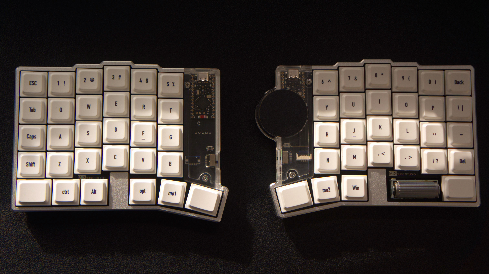
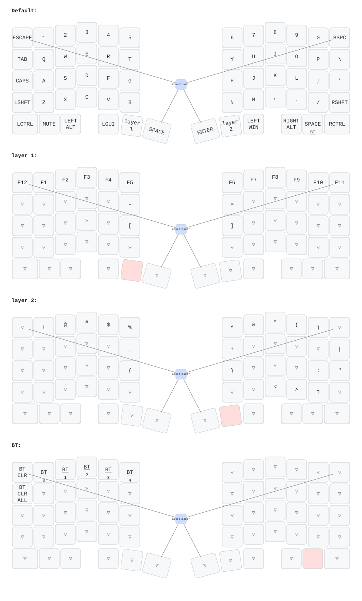

# MIX ZMK Firmware




**MIX** is a wireless split low-profile keyboard by **CUBE_STUDIO**. This repository contains its ZMK firmware: split-half builds, Cirque trackpad, metal rollers (EC11 encoders), Bluetooth profiles and ZMK Studio.

本仓库是 **CUBE_STUDIO MIX 无线分体矮轴键盘** 的 ZMK 固件，包含左右手固件、按键层、触控板、滚轮、蓝牙和 ZMK Studio 配置。

* 官网 / Website: [cubekb.com](https://cubekb.com) — 商店、使用说明、教程 / shop, user guides, tutorials
* MIX 使用说明 / MIX user guide: [cubekb.com/wiki/products/mix](https://cubekb.com/wiki/products/mix)
* 邮箱 / Email: [cubekb_studio@outlook.com](mailto:cubekb_studio@outlook.com)
* QQ 群 / QQ group: **1037094476**

---

## 官方资源 / Official Resources

购买、使用说明和各类教程都在工作室官网 [cubekb.com](https://cubekb.com)。本仓库只包含固件源码，日常使用请优先查看官网说明。

Shop, user guides and tutorials all live on the studio website [cubekb.com](https://cubekb.com). This repository only holds the firmware source; for everyday use, start with the website.

| 内容 Topic | 链接 Link |
| --- | --- |
| MIX 产品页（配置与购买） / Product page (options & purchase) | [shop/mix](https://cubekb.com/shop/mix) |
| **MIX 使用说明 / MIX user guide** | [wiki/products/mix](https://cubekb.com/wiki/products/mix) |
| · 快速上手 / Quick start | [#quick-start](https://cubekb.com/wiki/products/mix#quick-start) |
| · 蓝牙连接 / Bluetooth | [#bluetooth](https://cubekb.com/wiki/products/mix#bluetooth) |
| · 充电与电池 / Charging & battery | [#charging-and-battery](https://cubekb.com/wiki/products/mix#charging-and-battery) |
| · 默认键位 / Default keymap | [#default-keymap](https://cubekb.com/wiki/products/mix#default-keymap) |
| · 触控板与滚轮 / Touchpad & roller | [#touchpad-and-roller](https://cubekb.com/wiki/products/mix#touchpad-and-roller) |
| · 改键 / Remapping | [#remapping](https://cubekb.com/wiki/products/mix#remapping) |
| 刷机教程 / Flashing firmware | [guides/flash-firmware](https://cubekb.com/wiki/guides/flash-firmware) |
| 蓝牙配对 / Bluetooth pairing | [guides/bluetooth](https://cubekb.com/wiki/guides/bluetooth) |
| ZMK Studio 改键 / ZMK Studio | [guides/zmk-studio](https://cubekb.com/wiki/guides/zmk-studio) |
| ZMK Keymap Editor + GitHub | [guides/zmk-keymap-editor](https://cubekb.com/wiki/guides/zmk-keymap-editor) |
| 分体键盘基础 / Split keyboard basics | [guides/split-basics](https://cubekb.com/wiki/guides/split-basics) |
| 故障排查 / Troubleshooting | [guides/troubleshooting](https://cubekb.com/wiki/guides/troubleshooting) |
| 全部教程 / All guides | [wiki](https://cubekb.com/wiki) |
| 定制服务 / Custom builds | [#custom](https://cubekb.com/#custom) |
| 售后与保修 / Returns & warranty | [legal/returns](https://cubekb.com/legal/returns) |

---

## 功能特性 / Features

* ZMK `v0.3`, nice!nano v2 controllers, split targets `mix_left` / `mix_right`
* Cirque trackpad on the right half ([geeksville driver](https://github.com/geeksville/cirque-input-module): level-triggered interrupts, chip shutdown in deep sleep)
* Optional metal roller (EC11 encoder) on either half / 左右手可选金属滚轮
* 5 Bluetooth profiles, dedicated Bluetooth layer
* ZMK Studio (right half over USB)
* Idle after 3 min, deep sleep after 15 min / 3 分钟进入空闲，15 分钟进入深度睡眠

---

## 分支 / Branches

| 分支 Branch | 说明 Description |
| --- | --- |
| [`main`](../../tree/main) | 无屏幕版本，最省电；**未焊屏幕请用此分支** / No display, lowest power — use this if no screen is fitted |
| [`nice_view`](../../tree/nice_view) | 在 main 基础上增加左手 nice!view 屏幕 / `main` plus a nice!view screen on the left half |
| [`without-touchpad`](../../tree/without-touchpad) | 无触控板版本 / Build without the Cirque trackpad |

> 当前为 **main** 分支（无屏幕）。 / You are on the **main** branch (no display).

**下载固件 / Getting firmware**

1. 打开仓库的 **Actions** 页面，点击 **Build ZMK firmware**。
2. 在列表中选择**对应分支**最新一次成功的构建。
3. 在页面底部 **Artifacts** 下载 `firmware` 压缩包并解压。

1. Open **Actions** → **Build ZMK firmware**.
2. Pick the latest successful run **for the branch you want**.
3. Download the `firmware` artifact at the bottom of the page and unzip it.

> 切换分支时，左右手都需要重新刷入同一分支的固件，建议先刷一次 `settings_reset`。
> When switching branches, flash **both halves** from the same branch; flashing `settings_reset` first is recommended.

---

## 刷机 / Flashing

图文教程 / Illustrated guide: [刷机教程 Flashing firmware](https://cubekb.com/wiki/guides/flash-firmware)

**进入刷机模式 / Enter the bootloader**

* 同时按住 **Esc + Backspace + 拇指区 Space + Enter**（组合键），或快速双击控制器上的复位键。
* Press **Esc + Backspace + thumb Space + Enter** together (combo), or double-tap the reset button on the controller.

电脑上会出现一个名为 `NICENANO` 的 U 盘。 / A USB drive named `NICENANO` appears.

**刷入步骤 / Steps**

1. 首次刷机或从其他固件切换过来时，先给左右手各刷一次 `settings_reset`。
2. 左手刷 `mix_left` 固件，右手刷 `mix_right` 固件：把对应的 `.uf2` 文件拖进 U 盘，键盘会自动重启。
3. 在电脑上删除旧的 MIX 蓝牙配对，重新配对。

1. If this is the first flash, or you are coming from other firmware, flash `settings_reset` to both halves first.
2. Flash the `mix_left` `.uf2` to the left half and `mix_right` to the right half by copying it onto the drive; the board reboots automatically.
3. Remove the old MIX pairing on your computer and pair again.

> 组合键刷机需要键盘正在运行 MIX 固件；如果键盘无响应，请用双击复位键的方式。
> The combo only works while MIX firmware is running; if the keyboard is unresponsive, double-tap reset instead.

---

## 按键 / Keymap



官网说明 / On the website: [默认键位 Default keymap](https://cubekb.com/wiki/products/mix#default-keymap)

| 层 Layer | 名称 Name | 进入方式 Access | 内容 Contents |
| --- | --- | --- | --- |
| 0 | `Default` | — | 数字行 + QWERTY / Number row + QWERTY |
| 1 | `layer 1` | 按住左手 `MO 1` / hold left `MO 1` | F1–F12、`- = [ ]` |
| 2 | `layer 2` | 按住右手 `MO 2` / hold right `MO 2` | 上档符号 / Shifted symbols `! @ # … { } < > ?` |
| 3 | `BT` | 按住右手底排 `Space`（RCtrl 左侧，单击为空格） / hold the right bottom-row `Space` next to RCtrl (tap = space) | 蓝牙配置 1–5、清除配对 / BT profiles 1–5, clear bonds |

**滚轮 / Rollers**

| 层 Layer | 左滚轮 Left | 右滚轮 Right |
| --- | --- | --- |
| 0 `Default` | 音量 / Volume | 滚动 / Scroll |
| 1 `layer 1` | 音量 / Volume | 翻页 / Page Up · Down |
| 2 `layer 2` | 音量 / Volume | 方向键 / Arrow Up · Down |
| 3 `BT` | 音量 / Volume | 方向键 / Arrow Up · Down |

**蓝牙层 / Bluetooth layer**（按住 RCtrl 左侧的 Space / hold the `Space` next to RCtrl）

* 数字 `1`–`5`：切换蓝牙配置 1–5 / Select BT profile 1–5
* `Esc` 位置：清除当前配置的配对 / Clear current profile
* `Tab` 位置：清除全部配对 / Clear all profiles

**触控板 / Trackpad**

* 按住第 1 或第 2 层时，触控板变为滚动 / On layers 1 and 2 the trackpad scrolls instead of moving the pointer.
* 单击为鼠标左键，单击右上角区域为右键（[区域示意](https://cubekb.com/wiki/mix/touchpad-zones.svg)） / Tap = left click, tap the top-right zone = right click ([zone diagram](https://cubekb.com/wiki/mix/touchpad-zones.svg)).

修改按键请编辑 `config/mix.keymap`，或在 USB 连接右手时使用 [ZMK Studio](https://zmk.studio)（[教程](https://cubekb.com/wiki/guides/zmk-studio)）。也可以 fork 本仓库用 Keymap Editor 可视化修改（[教程](https://cubekb.com/wiki/guides/zmk-keymap-editor)）。
Edit `config/mix.keymap`, or use [ZMK Studio](https://zmk.studio) with the right half connected over USB ([guide](https://cubekb.com/wiki/guides/zmk-studio)). You can also fork this repo and edit visually with Keymap Editor ([guide](https://cubekb.com/wiki/guides/zmk-keymap-editor)).

---

## 触控板调节 / Trackpad Tuning

编辑 `config/mix_trackpad_config.dtsi` / Edit `config/mix_trackpad_config.dtsi`:

| 参数 Define | 默认 Default | 说明 Meaning |
| --- | --- | --- |
| `MIX_CIRQUE_SENSITIVITY` | `"2x"` | 灵敏度，`"1x"` 最灵敏 … `"4x"` 最迟钝 / ADC attenuation, `"1x"` most sensitive … `"4x"` least |
| `MIX_MOUSE_SPEED_NUM / DEN` | `5 / 2` | 指针速度倍率 / Pointer speed multiplier |
| `MIX_SCROLL_SPEED_NUM / DEN` | `1 / 30` | 滚动速度倍率，嫌慢可改为 `1 / 10` / Scroll speed (e.g. `1 / 10` for faster) |
| `MIX_SCROLL_LAYERS` | `1 2` | 触控板变为滚动的层 / Layers on which the trackpad scrolls |

### 省电：开启触控板休眠 / Power saving: trackpad sleep

触控板芯片默认不休眠，手指没放上去时也耗电约 **1.7 mA**，约占右手工作耗电的四分之三。开启芯片自带的休眠后，手指离开约 5 秒即降到约 **40 µA**，右手续航大约可以翻倍（按每天使用 8 小时估算，从约 2 个多月提高到约 4 个多月，1500 mAh 电池）。

The trackpad chip does not sleep by default and draws about **1.7 mA** even with no finger on it — roughly three quarters of the right half's awake current. With the chip's own sleep mode enabled it drops to about **40 µA** after ~5 s without touch, which roughly doubles right-half battery life (about 2 → 4+ months at 8 h/day with a 1500 mAh battery).

开启方法：编辑 `boards/shields/mix/mix_right.overlay`，去掉 `sleep;` 前的注释。
To enable it, uncomment `sleep;` in `boards/shields/mix/mix_right.overlay`:

```dts
glidepoint: glidepoint@0 {
    ...
    sleep;          // enable chip sleep mode
};
```

> 代价：触控板静置几秒后，再次触碰的第一下会有轻微延迟。默认关闭，按个人习惯选择。
> Trade-off: after the pad has been untouched for a few seconds, the first touch responds with a short delay. Disabled by default — choose what suits you.
>
> 无论是否开启，键盘深度睡眠（15 分钟无操作）时驱动都会让触控板芯片完全关断（约 0.23 µA）。
> Either way, the driver fully shuts the trackpad chip down (≈0.23 µA) when the keyboard enters deep sleep after 15 min.

---

## 固件配置 / Firmware Configuration

Shared options — `config/mix.conf`:

```conf
CONFIG_EC11=y
CONFIG_EC11_TRIGGER_GLOBAL_THREAD=y

CONFIG_ZMK_IDLE_TIMEOUT=180000         # idle after 3 min
CONFIG_ZMK_SLEEP=y
CONFIG_ZMK_IDLE_SLEEP_TIMEOUT=900000   # deep sleep after 15 min

CONFIG_BT_CTLR_TX_PWR_PLUS_8=y
CONFIG_ZMK_BLE_EXPERIMENTAL_CONN=y
```

Right half (central) — `config/mix_right.conf`:

```conf
CONFIG_ZMK_POINTING=y
CONFIG_ZMK_MOUSE=y
CONFIG_INPUT_THREAD_STACK_SIZE=2048

CONFIG_ZMK_STUDIO=y
CONFIG_ZMK_STUDIO_LOCKING=n
CONFIG_ZMK_STUDIO_LOCK_ON_DISCONNECT=n
```

### Build targets

| Target | Board | Shield / Snippet | Notes |
| --- | --- | --- | --- |
| Left half | `nice_nano_v2` | `mix_left` | Left half (no display) |
| Right half | `nice_nano_v2` | `mix_right` + `studio-rpc-usb-uart` | Central, trackpad, ZMK Studio |
| Settings reset | `nice_nano_v2` | `settings_reset` | Clears stored settings and bonds |

### External modules (`config/west.yml`)

| Module | Revision | Purpose |
| --- | --- | --- |
| [zmkfirmware/zmk](https://github.com/zmkfirmware/zmk) | `v0.3` | ZMK firmware |
| [geeksville/cirque-input-module](https://github.com/geeksville/cirque-input-module) | `main` | Cirque Pinnacle trackpad driver |

---

## 自行编译 / Building with GitHub Actions

1. Fork 本仓库，修改 `config/` 下的文件后推送，GitHub Actions 会自动编译。
2. 按上文「下载固件」获取 `.uf2` 文件。

1. Fork this repository, edit files under `config/` and push — GitHub Actions builds automatically.
2. Download the `.uf2` files as described in *Getting firmware* above.

### Repository structure

```text
.
├── build.yaml                    # Build matrix
├── boards/shields/mix/         # MIX shield: matrix, encoders, Cirque trackpad
├── config/
│   ├── west.yml                  # ZMK and module manifest
│   ├── mix.conf                  # Shared config: encoder, sleep, Bluetooth
│   ├── mix_right.conf            # Right half: trackpad, ZMK Studio
│   ├── mix_trackpad_config.dtsi  # Trackpad tuning
│   └── mix.keymap                # Keymap
├── doc/                          # Photos and generated keymap drawing
└── README.md
```

---

## 常见问题 / Troubleshooting

更多问题见官网 / More on the website: [故障排查 Troubleshooting](https://cubekb.com/wiki/guides/troubleshooting) · [蓝牙配对 Bluetooth pairing](https://cubekb.com/wiki/guides/bluetooth)

* **蓝牙连接异常 / Bluetooth issues**：两边刷 `settings_reset`，删除电脑上的配对后重新配对。 / Flash `settings_reset` to both halves, remove the pairing on the host and pair again.
* **左右手不通 / Halves not talking**：确认左右手刷的是同一分支、同一次构建的固件。 / Make sure both halves run firmware from the same branch and build.
* **触控板太快或太慢 / Trackpad too fast or slow**：见「触控板调节」。 / See *Trackpad Tuning*.

---

## 社区与支持 / Community & Support

* 官网 / Website: [cubekb.com](https://cubekb.com) — 商店、使用说明、教程 / shop, user guides, tutorials
* MIX 使用说明 / MIX user guide: [cubekb.com/wiki/products/mix](https://cubekb.com/wiki/products/mix)
* 邮箱 / Email: [cubekb_studio@outlook.com](mailto:cubekb_studio@outlook.com)
* QQ 群 / QQ group: **1037094476**

欢迎加群或发邮件交流编译、固件和改装问题。 / Join the group or email us for build help, firmware discussion and customization.

---

## 致谢 / Credits

* [ZMK Firmware](https://github.com/zmkfirmware/zmk)
* [geeksville/cirque-input-module](https://github.com/geeksville/cirque-input-module), a fork of [petejohanson/cirque-input-module](https://github.com/petejohanson/cirque-input-module)

Please refer to each upstream project for its license and documentation.
